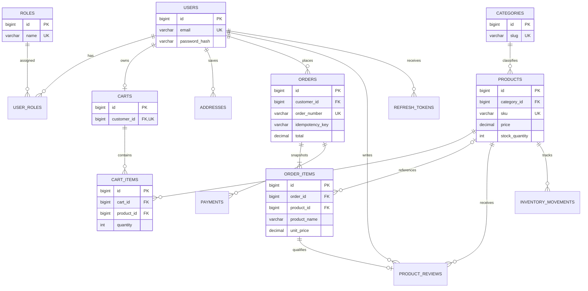

# Architecture and implementation plan

## System architecture

```text
Browser
  └── React 19 + Vite + React Router + Axios
       └── HTTPS REST/JSON (/api/v1)
            └── Spring Boot 3.5.x
                 ├── Controllers → DTO validation → Services → Repositories
                 ├── Spring Security (short-lived access token, rotating,
                 │   hashed refresh token in HttpOnly cookie, CSRF, RBAC)
                 └── Flyway → MySQL 8
```

The React application never connects directly to MySQL. The backend owns
authentication, authorization, input validation, pricing, stock checks, and
transaction boundaries. Controllers exchange DTOs and do not expose JPA
entities.

## Technology versions

| Layer | Baseline |
|---|---|
| Java | 21 LTS |
| Spring Boot | 3.5.x |
| Build | Maven Wrapper 3.9.9 |
| Frontend | React 19, Vite 7, JavaScript |
| Routing / HTTP / CSS | React Router 7, Axios 1, Bootstrap 5 |
| Database | MySQL 8.0+ |
| Schema management | Flyway |

The backend pins Spring Boot 3.5.7; the Maven wrapper pins 3.9.9. The frontend
manifest pins compatible semver ranges and its lockfile records the resolved
versions. Verify provider plans and networking before provisioning hosted
resources; the deployment guide records the current MySQL recommendation.

## Project structure

```text
.
├── backend/
│   ├── .mvn/wrapper/       # Maven 3.9.9 wrapper configuration
│   ├── Dockerfile
│   └── src/
│       ├── main/java/com/example/ecommerce/
│       │   ├── config/ security/ controller/
│       │   ├── service/ repository/ entity/
│       │   └── dto/ exception/
│       ├── main/resources/db/migration/
│       └── test/
├── database/
│   └── README.md
├── docs/
│   └── architecture.md
├── frontend/
│   ├── package.json
│   ├── vite.config.js
│   ├── vercel.json
│   └── src/
├── .env.example
├── .gitignore
└── README.md
```

Backend packages currently include `config`, `security`, `controller`,
`service`, `repository`, `entity`, `dto`, and `exception`.

## Database ER diagram



Migration foreign keys preserve order history and protect referenced catalog
data. Products are deactivated rather than physically removed in normal admin
flows. Order items keep a name, SKU, and price snapshot. Services enforce
ownership, delivered-purchase review eligibility, legal status transitions,
and locked inventory updates.

## Deployment approach

Build the frontend as static assets for Vercel (SPA rewrite included). Package
the Spring Boot API as a non-root Docker image and run it on a Java 21-capable
container service. Use managed MySQL with private networking or a restricted
backend IP allowlist. The deployment runbook recommends Aiven for MySQL; its
current product page lists MySQL 8.4 and a $5/month Developer plan for
test/personal projects, not production sizing. TLS, exact-origin credentialed
CORS, secure refresh cookies, secret-manager environment, startup migrations,
and database health checks are documented in [deployment.md](deployment.md).
The repository is deployable but has not been published to a cloud account.

## Staged implementation plan

1. **Foundation:** scaffold, ER model, migrations, backend/frontend build
   manifests, health check, and local setup.
2. **Persistence:** JPA entities/repositories, MySQL datasource, Flyway startup,
   production validation, and readiness checks.
3. **Identity:** customer registration, BCrypt, JWT access, rotating hashed
   refresh tokens, CSRF, logout, rate limiting, and safe admin bootstrap.
4. **Catalog API:** validated categories/products, server-side search/filter/
   pagination, stock adjustments, reviews, and admin endpoints.
5. **Catalog UI:** responsive homepage, category links, search/filter/sort,
   product details, add-to-bag, and review display.
6. **Customer workspace:** profile/password change, owned addresses, persistent
   cart, server-calculated totals, and frontend account/cart pages.
7. **Orders:** COD checkout, row-locked stock, order snapshots, idempotency,
   ownership-scoped history, cancellation, and status transitions.
8. **Administration:** dashboard, product/category/inventory/customer/order
   management, guarded by server-side ADMIN authorization.
9. **Quality/security:** backend H2 integration/security tests, input
   validation, safe errors, CSRF/CORS, rate limits, and OpenAPI.
10. **Deployment:** Java 21 Docker image, production profile, Vercel SPA
    rewrite, environment contract, and hosted-MySQL runbook. Actual cloud
    provisioning still requires operator accounts and credentials.
